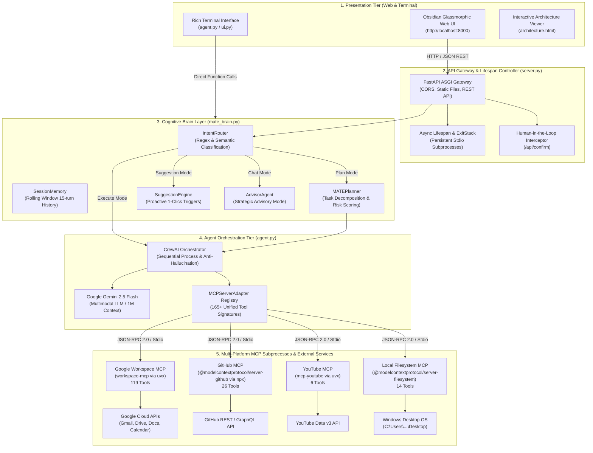
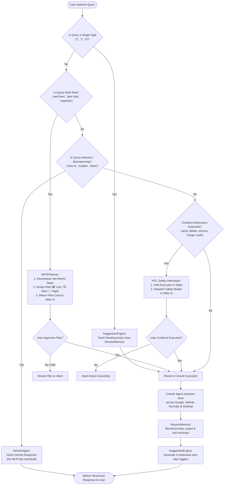
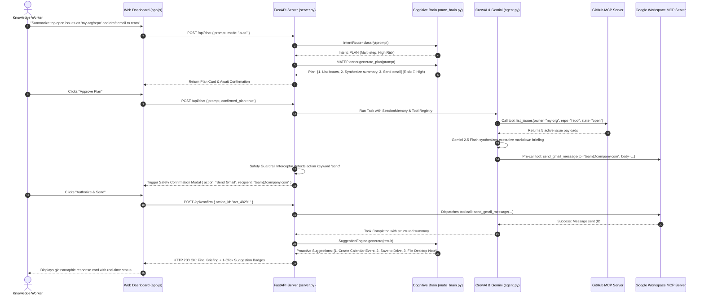

# 🏛️ Deliverable 3: Architecture Diagram & Technical Design

**Project:** MATE — Intelligent Multi-Platform AI Co-Pilot  
**Team:** Alpha And Beta  
**Lead:** Gowtham Datta Sai V | **Member:** Sai Teja  
**Date:** October 2026  
**Interactive Visualizer:** [Launch Interactive Architecture Dashboard](file:///c:/MATE/docs/architecture.html)

---

## 1. High-Level Multi-Tier System Architecture

MATE operates on a decoupled, 5-tier architecture that separates the user interface, API gateway, cognitive orchestration brain, autonomous agents, and underlying Model Context Protocol (MCP) servers.



---

## 2. Cognitive Flow & Intent Routing Architecture

The `IntentRouter` analyzes raw user prompts before invoking costly LLM tool-calling loops. This reduces token waste, lowers latency, and ensures high safety for mutating operations.



---

## 3. End-to-End Sequence Diagram (Cross-Platform Execution with HITL)

The sequence diagram below illustrates a cross-platform command: **"Summarize unread GitHub issues and email the briefing to the team."**



---

## 4. MCP Subprocess Lifecycle & Process Management

MATE uses Python's asynchronous `contextlib.ExitStack` within FastAPI's `lifespan` hook to manage external processes:

| Component | Execution Command | Transport | Communication Standard |
| :--- | :--- | :--- | :--- |
| **Google Workspace** | `uvx --from workspace-mcp workspace-mcp --single-user --tool-tier complete` | Standard I/O (Stdio) | JSON-RPC 2.0 |
| **GitHub** | `npx -y @modelcontextprotocol/server-github` | Standard I/O (Stdio) | JSON-RPC 2.0 |
| **YouTube** | `uvx --with mcp<2 --from mcp-youtube mcp-youtube` | Standard I/O (Stdio) | JSON-RPC 2.0 |
| **Desktop Filesystem**| `npx -y @modelcontextprotocol/server-filesystem <DESKTOP_DIR>` | Standard I/O (Stdio) | JSON-RPC 2.0 |

### Lifecycle Resilience Features:
1. **Zero Cold-Start Tool Invocations:** MCP subprocesses are spawned once at server startup and kept alive, reducing tool-call latency from seconds to milliseconds.
2. **Graceful Degradation:** If any MCP server fails during initialization (e.g. invalid GitHub token), the remaining servers initialize successfully. The UI displays an amber warning status rather than crashing.
3. **Clean Shutdown:** On server termination (`SIGINT` / `SIGTERM`), the `ExitStack` cleanly closes standard input/output pipes and terminates child processes without leaving orphaned background processes.

---

## 5. Security & Isolation Matrix

```
┌────────────────────────────────────────────────────────┐
│                   Untrusted Network                    │
└───────────────────────────┬────────────────────────────┘
                            │ HTTPS / Localhost
┌───────────────────────────▼────────────────────────────┐
│          MATE Security & Sandbox Boundary              │
│                                                        │
│  [1] Credential Security:                              │
│      - Tokens stored strictly in local .env & OS disk  │
│      - No external telemetry or cloud sync             │
│                                                        │
│  [2] Execution Sandboxing:                             │
│      - Local Filesystem scoped strictly to Desktop     │
│      - Restrictive path resolution prevents /etc/ or   │
│        system directory traversal                      │
│                                                        │
│  [3] Human-in-the-Loop Interceptor:                   │
│      - Zero automated execution of destructive tools   │
│      - Explicit user token approval per action         │
└────────────────────────────────────────────────────────┘
```
